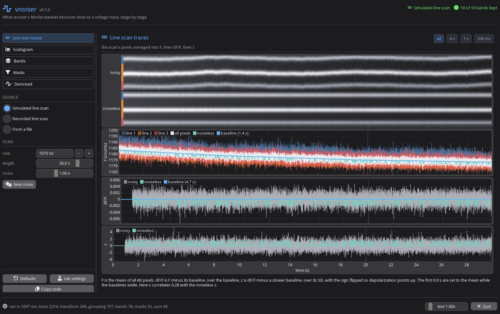

# imgui_vnoiser

A window that shows what [vnoiser](https://github.com/FlynnOConnell/vnoiser)'s Morlet wavelet denoiser does to a
voltage trace, one stage per page:

    denoised = sum over bands of (band x mask) + the input's slow part

Each page has its settings in the rail on the left and its plots on the right. Changing a setting reruns that stage
and the ones after it. The stages call vnoiser's own classes, and the output matches `Denoiser.run`
(`tests/test_pipeline.py`).

The window is styled like the masknmf launcher and
[imgui_lab4_interface](https://github.com/FlynnOConnell/imgui_lab4_interface): imgui-data-loader's shell, the same
palette, Font Awesome icons.



## What vnoiser does

It works on one trace at a time. The trace is z-scored dF/F of a domain, made by `vnoiser.preprocess.domain_zscore`:

1. F: the mean of the domain's pixels
2. dF/F = (F - baseline) / baseline, the baseline a Gaussian filter of F (sigma 1500 samples)
3. the first 1000 samples, where the filters start up, set to the mean of the rest
4. z = -(dF/F - a slower baseline, sigma 5000) / SD(dF/F); the sign flip makes depolarization positive

`Denoiser.run(z)` then:

| step | what it does | page |
|------|--------------|------|
| transform | complex Morlet CWT (`cmor0.5-1.0`), 100 log-spaced scales from 1 to 1000 samples | Scalogram |
| grouping | standardize each row, take its absolute value, PCA, Ward clustering into up to 10 bands | Bands |
| bands | each band is the mean of its rows, savgol-smoothed at or below 75 Hz; a band with no event is dropped | Masks |
| masks | an event opens where the band crosses 2 SD (2.5 at 30 Hz and up); the mask is 1 on events, a floor elsewhere (0.7, 0.5, 0.2, 0.1 from slow to fast), Gaussian-blurred | Masks |
| sum | each band / sqrt(its mean scale) x its mask, added up, plus a 1 Hz zero-phase FIR low-pass of the input | Denoised |

The output has the input's length and z units. It is not amplitude-preserving: a band averages its rows instead of
summing them, so with every mask at 1 the sum passes about 0.5 to 0.9 of a sine between 10 and 200 Hz (the white
curve on the Bands page), and between events each band is cut to its floor.

`Denoiser.upstream` holds the lab's original settings: bands above 75 Hz stay complex, and the floor above 80 Hz is
0.01 instead of 0.1. **Defaults** and **Lab settings** at the bottom of the rail switch between the two; **Copy
code** copies the Python for the current settings.

## On the default scan

The default input is a simulated AOD line scan: 3 lines across one dendrite, 40 px, 1075 Hz for 30 s, in raw counts
with the file's offset left in, with bleaching, motion and shot noise. The same scan without noise or motion runs
beside it.

There, z correlates 0.28 with the noiseless z, and the denoised trace 0.59. The input's spectrum reaches its noise
floor near 16 Hz. All 10 bands find events, but the 6 above 16 Hz find 893 of the 1002, and those are mostly noise
crossing the threshold. A recorded scan (unit 30 of `turi/9_14_2026`, line 0, 1587 Hz) looks the same: the floor
starts near 16 Hz, and the 6 bands above it find 917 of 1003 events.

## Pages

| page | shows |
|------|-------|
| [Line scan traces](docs/signal.png) | the scan's pixels, noisy above noiseless; F per line and for all pixels, with its baseline; dF/F with the slower baseline; z |
| [Scalogram](docs/scalogram.png) | the transform, one row per frequency, with the band edges; one row against the input |
| [Bands](docs/bands.png) | which rows each band holds and the gain of their sum; the spectrum with the bands behind it; how long each band is kept, and its events |
| [Masks](docs/events.png) | one band: its rows and their mean, the thresholds and events, its mask, the band times its mask; every band's mask |
| [Denoised](docs/final.png) | each masked band; the bands added up; what the denoiser took out; the spectra |

Under the plots, a paragraph says what the page shows with this trace's numbers in it, and what to check.

Every time plot shares one x range: drag to pan, scroll to zoom, double-click to fit, or use the buttons at the
right of the page title.

## Install

Needs a vnoiser checkout next to this one (`../vnoiser`, see `[tool.uv.sources]` in `pyproject.toml`).

```bash
git clone git@github.com:FlynnOConnell/vnoiser.git
git clone git@github.com:FlynnOConnell/imgui_vnoiser.git
cd imgui_vnoiser
uv venv -p 3.12 && uv pip install -e ".[dev]"
imgui-vnoiser
```

Install with `-e`: a plain `uv pip install .` copies the package, and later edits don't reach the window.

## Recorded line scans

The window opens AOD line scans exported from a `.mesc`. The export needs mbo_utilities, so it runs in
pml_utilities' environment:

```bash
cd ../pml_utilities
uv run --no-sync python ../imgui_vnoiser/scripts/export_mesc_linescan.py ~/data/turi/9_14_2026/session1.mesc
```

That writes `linescans/<unit>.npz` next to the file, with every line's raw pixels (offset left in, as the voltage
pipeline reads them). Scans under `~/data/**/linescans/` are listed under Recorded line scan; tick the lines that
make up the domain and pick a time window. The dF/F baselines are scaled to the scan's frame rate, as mbo_utilities
does. From the command line: `imgui-vnoiser --scan ~/data/turi/9_14_2026/linescans/MSession_0_MUnit_30.npz --lines 0 1`.

## Text size

GLFW reports a content scale of 1 under XWayland, so the desktop scale has no effect on the window. Set it in the
app instead: Ctrl + and Ctrl - (Ctrl 0 resets), the text slider in the footer, or `imgui-vnoiser --scale 2`
(`IMGUI_VNOISER_SCALE=2`). The last value is saved in `~/.imgui_vnoiser/settings.json`. With nothing saved, the
default comes from `GDK_SCALE`, then Hyprland's monitor scale, then 1.

## Tests and screenshots

```bash
pytest                          # 21 tests, about 20 s; one draws every page on a null backend
python scripts/screenshot.py    # docs/<page>.png; needs pillow
imgui-vnoiser --page bands --screenshot bands.png
```

## Layout

| file | contents |
|------|----------|
| `src/imgui_vnoiser/signals.py` | the simulated line scan, recorded scans, traces from files |
| `src/imgui_vnoiser/morlet.py` | the wavelet's name, frequency response and transform |
| `src/imgui_vnoiser/pipeline.py` | `Settings`, staged `compute`, per-band details |
| `src/imgui_vnoiser/style.py` | the palette, the theme and the colormaps |
| `src/imgui_vnoiser/plotting.py` | ImPlot helpers |
| `src/imgui_vnoiser/config.py` | saved UI scale and its detection |
| `src/imgui_vnoiser/app.py` | the window |
| `scripts/export_mesc_linescan.py` | `.mesc` line scans to `.npz` |
| `scripts/screenshot.py` | the page screenshots in `docs/` |

See [ARCHITECTURE.md](ARCHITECTURE.md).
