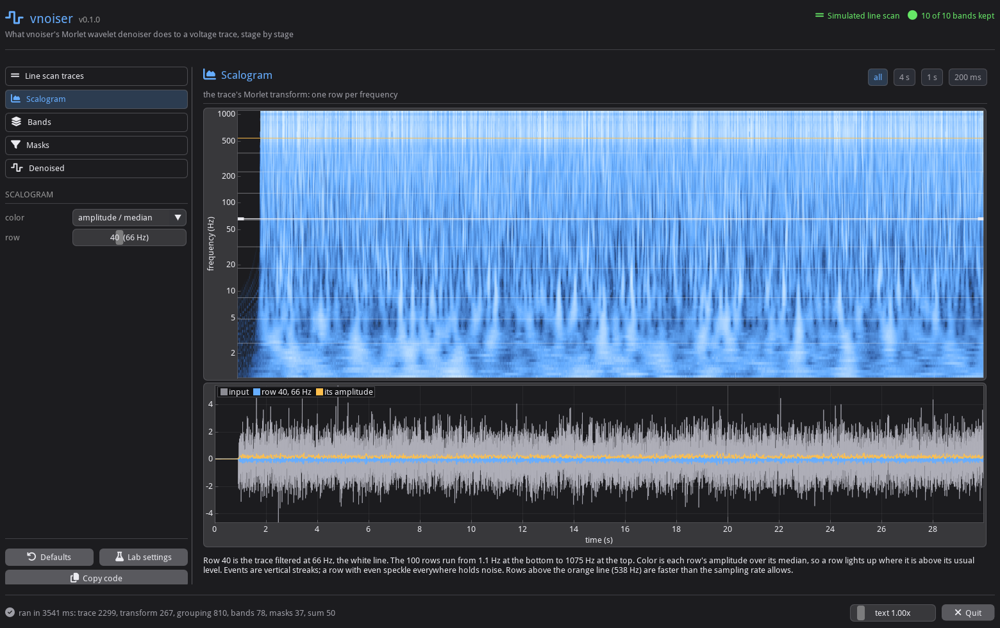

# imgui_vnoiser

Interactive viewer for [vnoiser](https://github.com/FlynnOConnell/vnoiser)'s Morlet wavelet denoiser. Each page is
one stage of `vnoiser.Denoiser.run`, with its parameters on the left and its plots on the right. Changing a
parameter reruns that stage and the ones after it. The stages call vnoiser's classes directly, and the output
matches `Denoiser.run` (`tests/test_pipeline.py`).

Built on [imgui-bundle](https://github.com/pthom/imgui_bundle) (ImGui + ImPlot).



## What vnoiser does

Per trace, 1-D, no spatial step.

**Input to `Denoiser.run`:** one float trace `(n_frames,)` plus `fs`. It is expected to be z-scored dF/F, made
upstream by `vnoiser.preprocess.domain_zscore`:
1. mean fluorescence over the domain's pixels
2. dF/F = (F - baseline) / baseline, Gaussian baseline with sigma 1500 samples
3. z = -(dF/F - slower Gaussian baseline, sigma 5000) / SD(dF/F)

The sign flip makes depolarization positive.

**Operations:**
1. Complex Morlet CWT (`pywt.cwt`, `cmor0.5-1.0`), 100 log-spaced scales 1 to 1000 (fs down to fs/1000 Hz).
2. Group the 100 rows into 10 frequency bands: PCA on the standardized |W| of each row, then Ward clustering.
3. Per band: mean of its rows (real part), savgol smoothing for bands at or below 75 Hz, then event windows by
   threshold crossing (2 / 2.5 SD of the band trace). Bands with no events are dropped.
4. Per band mask: 1 inside the (widened) windows, a floor outside (soft: 0.7 / 0.5 / 0.2 / 0.1 by band frequency),
   Gaussian-smoothed.
5. Sum of (band / sqrt(mean scale) x mask) over bands, plus a 1 Hz zero-phase FIR low-pass of the input.

**Output:** `denoised (n_frames,)`, the same length and time base as the input, plus event start indices. The
stored archive trace (`denoised_trace_scans.pkl`) is step 5 without the 1 Hz baseline.

**Scaling:** the output is in the input's z units, with no rescaling to match the input. It is not
amplitude-preserving:
- Each band is the mean (not the sum) of its rows, divided by sqrt(mean scale). For a sine with every mask at 1, this
  passes about 0.5 to 0.9 of its amplitude (defaults, fs 1075 Hz), depending on frequency.
- Between events, each band is multiplied by its floor (0.1 to 0.7).
- Event peaks come back smaller than in the input.
- The 1 Hz baseline is added at gain 1.

## Install

Needs a vnoiser checkout next to this one (`../vnoiser`, see `[tool.uv.sources]` in `pyproject.toml`).

```bash
git clone git@github.com:FlynnOConnell/vnoiser.git
git clone git@github.com:FlynnOConnell/imgui_vnoiser.git
cd imgui_vnoiser
uv venv -p 3.12 && uv pip install -e ".[dev]"
imgui-vnoiser
```

## Text size

GLFW reports a content scale of 1 under XWayland, so the desktop scale has no effect on the window. Set it in the
app instead:

- Ctrl + / Ctrl - to resize, Ctrl 0 to reset to the detected scale
- the text size slider at the bottom of the left panel
- `imgui-vnoiser --scale 2` or `IMGUI_VNOISER_SCALE=2`

The last value is saved in `~/.imgui_vnoiser/settings.json`. With nothing saved, the default comes from
`GDK_SCALE`, then Hyprland's monitor scale, then 1.

## Pages

| page | plots | parameters |
|------|-------|------------|
| 1 Signal | input trace, ground truth, power spectrum | source, fs, duration, noise SD, file and column |
| 2 Morlet wavelet | wavelet at one row, time-frequency tiles, frequency response of every row, summed gain | B, C, scale range, number of rows |
| 3 Scalogram | \|W\|, \|W\| / row median, standardized \|W\|, or Re W; one row against the input; sum of all rows | color mode, row |
| 4 Frequency bands | band membership over frequency, band-sum gain, PCA scatter, explained variance, Ward tree | PCA components, PCs clustered, linkage, number of bands |
| 5 Events and masks | band trace with open/close levels and windows, mask before and after blur, masked band, all masks | open levels, savgol windows, complex fast bands, soft/hard, floors, blur SD |
| 6 Reconstruction | per-band contributions, denoised vs raw vs ground truth, removed signal, spectra | baseline filter, add baseline, bands in the sum |

All time plots share one x range (drag to pan, scroll to zoom, double-click to fit). The buttons at the bottom of
the left panel reset to `Denoiser()` defaults, switch to `Denoiser.upstream`, or copy the equivalent `Denoiser(...)`
call to the clipboard.

## Things to try

1. Compare the bands for Spikes and bumps vs JEDI3sub. Band edges change with the trace, and fast bands can
   interleave.
2. The band-sum gain on the Frequency bands page is about 0.5 to 0.9, because each band averages its rows instead of
   summing them. Spikes in the reconstruction are smaller than in the ground truth.
3. Switch masks from soft to hard: the floor drops to 0.05, removing more noise between events and more of the slow
   components.
4. Untick bands on the Reconstruction page to see what each contributes.

## Layout

| file | contents |
|------|----------|
| `src/imgui_vnoiser/signals.py` | synthetic traces, test signals, file loading |
| `src/imgui_vnoiser/morlet.py` | cmor wavelet shape, widths and frequency response |
| `src/imgui_vnoiser/pipeline.py` | `Settings`, staged `compute`, per-band details |
| `src/imgui_vnoiser/plotting.py` | ImPlot helpers |
| `src/imgui_vnoiser/config.py` | saved UI scale and its detection |
| `src/imgui_vnoiser/app.py` | the window |

See [ARCHITECTURE.md](ARCHITECTURE.md).
