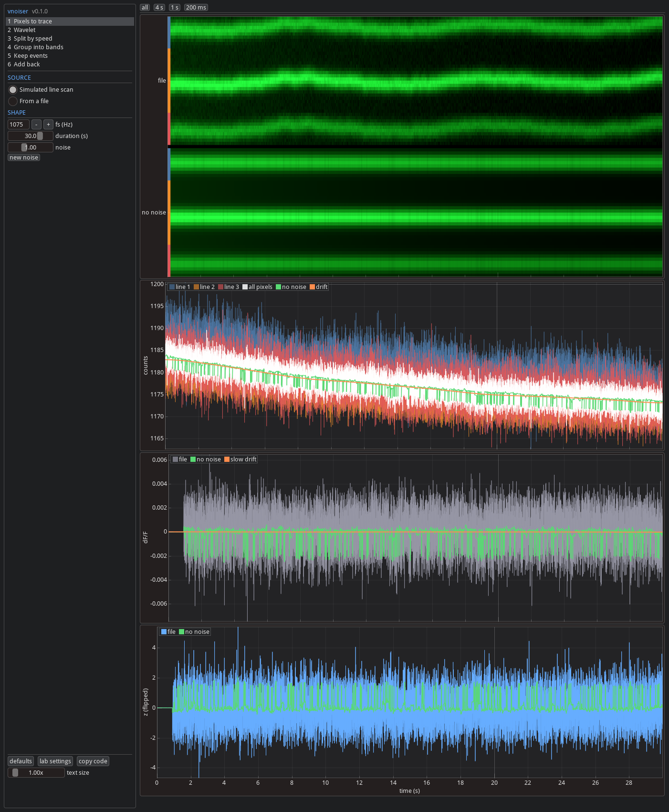

# imgui_vnoiser

Interactive viewer for [vnoiser](https://github.com/FlynnOConnell/vnoiser)'s Morlet wavelet denoiser. Each page is
one stage of `vnoiser.Denoiser.run`, with its parameters on the left and its plots on the right. Changing a
parameter reruns that stage and the ones after it. The stages call vnoiser's classes directly, and the output
matches `Denoiser.run` (`tests/test_pipeline.py`).

Built on [imgui-bundle](https://github.com/pthom/imgui_bundle) (ImGui + ImPlot).



## What vnoiser does

In short: split the trace into slow-to-fast wiggles, group similar speeds into bands, keep each band where it
clearly sticks out above its own noise and turn it down elsewhere, then add the bands back together. The details:

Per trace, 1-D, no spatial step.

**Input to `Denoiser.run`:** one float trace `(n_frames,)` plus `fs`. It is expected to be z-scored dF/F, made
upstream by `vnoiser.preprocess.domain_zscore`:
1. mean fluorescence over the domain's pixels
2. dF/F = (F - baseline) / baseline, Gaussian baseline with sigma 1500 samples
3. the first 1000 samples (filter start-up) replaced by the mean of the rest
4. z = -(dF/F - slower Gaussian baseline, sigma 5000) / SD(dF/F)

The sign flip makes depolarization positive.

**Operations:**
1. Complex Morlet CWT (`pywt.cwt`, `cmor0.5-1.0`), 100 log-spaced scales 1 to 1000 (fs down to fs/1000 Hz).
2. Group the 100 rows into up to 10 frequency bands: standardize each row, take the absolute value, PCA, then Ward
   clustering.
3. Per band: mean of its rows (real part), savgol smoothing for bands at or below 75 Hz, then event windows by
   threshold crossing (2 / 2.5 SD of the band trace). Bands with no events are dropped.
4. Per band mask: 1 inside the (widened) windows, a floor outside (soft: 0.7 / 0.5 / 0.2 / 0.1 by band frequency),
   Gaussian-smoothed.
5. Sum of (band / sqrt(mean scale) x mask) over bands, plus a 1 Hz zero-phase FIR low-pass of the input.

**Output:** `denoised (n_frames,)`, the same length and time base as the input, plus event start indices.

**Two settings:** `Denoiser()` (the defaults above) or `Denoiser.upstream` (the lab's original settings: bands above
75 Hz kept complex, a 0.01 floor above 80 Hz instead of 0.1). The buttons at the bottom of the left panel switch
between them.

**Scaling:** the output is in the input's z units, with no rescaling to match the input. It is not
amplitude-preserving:
- Each band is the mean (not the sum) of its rows, divided by sqrt(mean scale). For a sine with every mask at 1, this
  passes about 0.5 to 0.9 of its amplitude between roughly 10 and 200 Hz, and less toward 1 Hz and 400 Hz
  (defaults, fs 1075 Hz).
- Between events, each band is multiplied by its floor (0.1 to 0.7).
- Event peaks come back smaller than in the input.
- The 1 Hz baseline is added at gain 1.

## Install

Needs a vnoiser checkout next to this one (`../vnoiser`, see `[tool.uv.sources]` in `pyproject.toml`).

```bash
git clone git@github.com:FlynnOConnell/vnoiser.git
git clone git@github.com:FlynnOConnell/imgui_vnoiser.git
cd imgui_vnoiser
uv venv -p 3.12 && uv pip install -e ".[dev]"
imgui-vnoiser
```

## Recorded line scans

The window opens AOD line scans exported from a `.mesc`. The export needs mbo_utilities, so it runs in
pml_utilities' environment:

```bash
cd ../pml_utilities
uv run --no-sync python ../imgui_vnoiser/scripts/export_mesc_linescan.py ~/data/turi/9_14_2026/session1.mesc
```

That writes `linescans/<unit>.npz` next to the file: every line's raw pixels (offset left in, as the voltage pipeline
reads them). Scans under `~/data/**/linescans/` show up under "Recorded line scan"; pick the lines that make up the
domain and a time window. The dF/F baselines are scaled to the scan's frame rate as mbo_utilities does.

## Text size

GLFW reports a content scale of 1 under XWayland, so the desktop scale has no effect on the window. Set it in the
app instead:

- Ctrl + / Ctrl - to resize, Ctrl 0 to reset to the detected scale
- the text size slider at the bottom of the left panel
- `imgui-vnoiser --scale 2` or `IMGUI_VNOISER_SCALE=2`

The last value is saved in `~/.imgui_vnoiser/settings.json`. With nothing saved, the default comes from
`GDK_SCALE`, then Hyprland's monitor scale, then 1.

## Pages

| page | shows |
|------|-------|
| 1 Line scan traces | a simulated AOD line scan (raw counts, offset left in, motion, bleaching, shot noise) next to the same scan without noise, at each step: pixels, averages, dF/F, the final trace |
| 2 Split by speed | the trace split into rows, slow to fast; one row; all rows added back |
| 3 Group into bands | which rows go in which band, and how the grouping is made |
| 4 Keep events | a band's rows and their average, where it sticks out, its mask, every band's mask |
| 5 Add back | each band after masking, the bands added together, what was removed |

All time plots share one x range (drag to pan, scroll to zoom, double-click to fit). The buttons at the bottom of
the left panel switch between vnoiser's defaults and the lab's settings, or copy the matching code.

## Things to try

1. Raise the noise on the first page and watch how far the file's trace drifts from the noiseless one.
2. The gain curve on the Group into bands page is about 0.5 to 0.9 over most of the range, because each band
   averages its rows instead of summing them. Events in the reconstruction are smaller than in the ground truth.
3. Switch masks from soft to hard: the floor drops to 0.05, removing more noise between events and more of the slow
   components.
4. Untick bands on the Add back page to see what each contributes.

## Layout

| file | contents |
|------|----------|
| `src/imgui_vnoiser/signals.py` | synthetic line scan and traces, file loading |
| `src/imgui_vnoiser/morlet.py` | the wavelet's name, frequency response and transform |
| `src/imgui_vnoiser/pipeline.py` | `Settings`, staged `compute`, per-band details |
| `src/imgui_vnoiser/plotting.py` | ImPlot helpers |
| `src/imgui_vnoiser/config.py` | saved UI scale and its detection |
| `src/imgui_vnoiser/app.py` | the window |

See [ARCHITECTURE.md](ARCHITECTURE.md).
